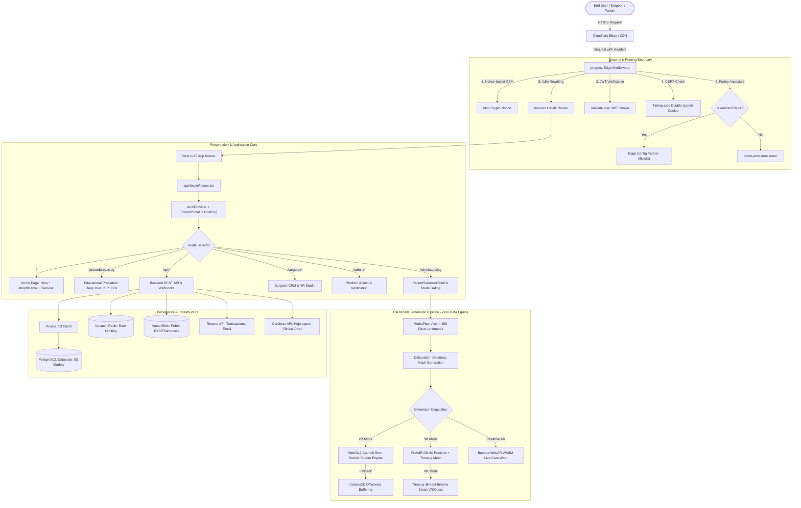

# Faceify Labs — Application Architecture

## 1. High-Level Architectural Flow

---

## 2. Architectural Layers

### A. Edge Security Layer (`proxy.ts`)
1. **Per-Request CSP Nonce**: Every response receives a dynamically generated cryptographic nonce. Inline scripts must match this nonce to execute.
2. **Embed Frame Ancestors**: For standard routes, `frame-ancestors 'none'` is enforced. For `/embed/*` routes, dynamic allowlists (stored in Vercel Edge Config or local JSON) restrict iframe framing strictly to approved partner clinic domains.
3. **Stateless JWT Validation**: Validates session cookies via `jose`. Protects `/surgeon`, `/admin`, `/patient`, and private simulator routes before React Server Components render.
4. **Sliding-Window Session Refresh**: Sessions nearing half of their 30-day lifetime are automatically refreshed with an updated expiration header.

### B. Internationalization Strategy (`next-intl`)
- Supported Locales: English (`en`, default), Thai (`th`), Korean (`ko`), Portuguese (`pt`), Japanese (`ja`).
- Routing: `localePrefix: 'as-needed'` ensures clean URLs for default English while prefixing international routes (e.g., `/th/simulate/rhinoplasty`).
- Performance: Translation dictionaries are loaded server-side per request, preventing bloated client JavaScript bundles.

### C. Client-Side Simulation Pipeline (Zero Data Egress)
The core clinical mandate is that **no patient photo ever leaves the browser**.
1. **Ingestion**: Patient photos are ingested locally and normalized (EXIF orientation, max 1024px constraint).
2. **Landmark Extraction**: `@mediapipe/tasks-vision` extracts 468 3D facial coordinates on an offscreen canvas.
3. **Mesh Triangulation**: `delaunator` computes Delaunay triangulation combining the 468 landmarks with 16 boundary anchor points into ~900 triangles.
4. **Deformation Engine**:
   - **Primary Path**: WebGL2 shader with interleaved vertex buffers and 16-tap Catmull-Rom bicubic texture sampling.
   - **Fallback Path**: Canvas 2D affine transform clipping per triangle with dirty-rect optimization.
   - **3D Path**: Parametric FLAME neural mesh fitted via ONNX Runtime Web and rendered with Three.js.
   - **AR Path**: Live webcam stream deformation powered by Banuba WebAR.
