# Faceify Labs — Component Dependency Mapping

## 1. Global Component Hierarchy

```mermaid
graph TD
    RootLayout[app/locale/layout.tsx] --> AuthProvider[components/AuthProvider.tsx]
    RootLayout --> SmoothScroll[components/SmoothScroll.tsx]
    RootLayout --> PostHog[components/PostHogProvider.tsx]
    RootLayout --> Navbar[components/Navbar.tsx]
    RootLayout --> Footer[components/Footer.tsx]
    RootLayout --> LazyChatbot[components/LazyChatbot.tsx]
    RootLayout --> CookieConsent[components/CookieConsent.tsx]

    subgraph Homepage View
        RootLayout --> HomePage[app/locale/page.tsx]
        HomePage --> HeroSection[components/homepage/HeroSection.tsx]
        HeroSection --> HeroMorphDemo[components/homepage/HeroMorphDemo.tsx]
        HomePage --> FeaturedDealsSection[components/homepage/FeaturedDealsSection.tsx]
        HomePage --> ProcedureCarousel[components/homepage/ProcedureCarousel.tsx]
        HomePage --> HowItWorks[components/homepage/HowItWorks.tsx]
        HomePage --> ROISection[components/homepage/ROISection.tsx]
        HomePage --> FinalCTA[components/homepage/FinalCTA.tsx]
    end

    subgraph Simulation View
        RootLayout --> SimPage[app/locale/simulate/rhinoplasty/page.tsx]
        SimPage --> SimShell[components/simulation/PatientSimulatorShell.tsx]
        SimShell --> DimProvider[lib/simulator-dimension]
        DimProvider --> RhinoWrapper[components/simulation/RhinoplastySimulatorWrapper.tsx]
        RhinoWrapper --> RhinoParams[lib/simulation/rhinoplasty-params-context.tsx]
        RhinoWrapper --> Patient2DSim[components/simulation/PatientRhinoplastySimulator.tsx]
        RhinoWrapper --> Patient3DSim[components/simulation/PatientRhinoplasty3DSimulator.tsx]
        RhinoWrapper --> RealtimeAR[components/simulation/RealtimeMode.tsx]
        Patient2DSim --> HUDOverlay[components/ui/hud/LandmarkOverlay.tsx]
        Patient2DSim --> SplitSlider[components/homepage/BeforeAfterSlider.tsx]
    end

    subgraph Procedure View
        RootLayout --> ProcPage[app/locale/procedures/slug/page.tsx]
        ProcPage --> ProcHero[components/procedures/ProcedureHero.tsx]
        ProcPage --> ScreenshotHero[components/procedures/ProcedureScreenshotHero.tsx]
        ProcPage --> MiniMorphos[components/procedures/MiniMorphos.tsx]
        ProcPage --> LogicStrip[components/procedures/LogicStrip.tsx]
        ProcPage --> PricingSidebar[components/ProcedurePricingSidebar.tsx]
        ProcPage --> CostEstimator[components/procedures/ProcedureCostEstimator.tsx]
        ProcPage --> StickyNav[components/procedures/ProcedureStickyNav.tsx]
    end
```

---

## 2. Architectural Impact of Shared Component Changes

| Component | Files Depending On It | Impact of Changes | Risk Level |
| :--- | :--- | :--- | :--- |
| **`components/Navbar.tsx`** | All 250 Page Routes | Header layout, mobile drawer, localized links, login modal trigger. | **Critical (P0)** |
| **`components/Footer.tsx`** | All 250 Page Routes | Medical compliance disclaimers, procedure links, copyright. | **High** |
| **`components/SmoothScroll.tsx`** | Global layout | Wheel hijacking, Lenis scroll lifecycle, page transition resets. | **High** |
| **`components/simulation/PatientSimulatorShell.tsx`** | 57 Simulator Routes | Surgical chrome, consult-required disclaimers, clinical badges. | **Critical (P0)** |
| **`lib/simulation/warp-engine.ts`** | All 2D Simulators | WebGL canvas rendering, bicubic shaders, triangulation caching. | **Critical (P0)** |
| **`data/procedures.ts`** | Whole Codebase | Single source of truth for 88 procedures, pricing, and routes. | **Critical (P0)** |
